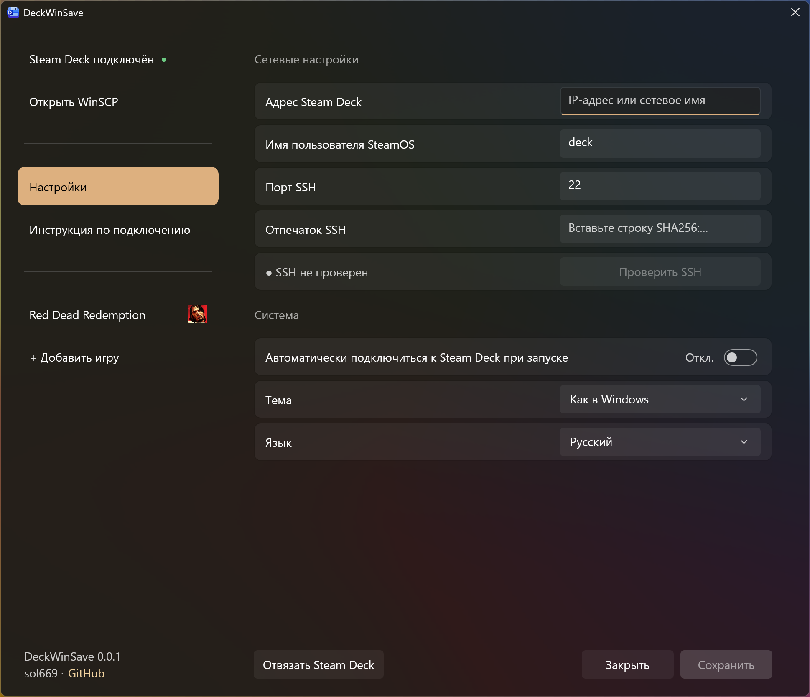
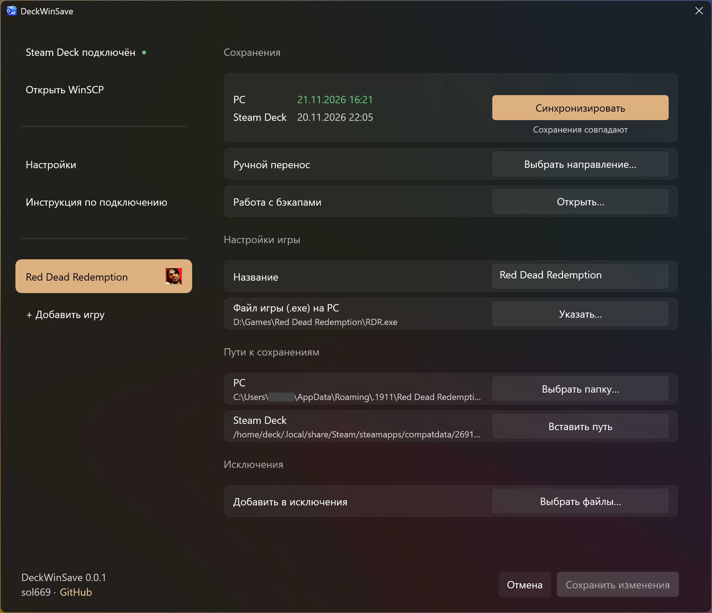

# DeckWinSave

**DeckWinSave — альтернатива Steam Cloud для «сторонних» игр. Легко переносите сохранения между Windows и Steam Deck в обе стороны и продолжайте игру с того же места!**

- **Подключение по SSH: простая настройка защищённого соединения между Windows и Steam Deck прямо в DeckWinSave.**

- **Резервные копии:  перед заменой сохранений DeckWinSave автоматически создаёт бэкап, чтобы можно было вернуть прежний прогресс.**

- **Обмен файлами: WinSCP уже в комплекте - открывайте папки SteamOS из DeckWinSave и переносите файлы между устройствами.**

- **Облачное хранилище: **синхронизация сохранений через Яндекс Диск и Google Drive (в разработке)

## Инструкция

Инструкция также доступна в приложении и через кнопку «Открыть в TXT». [English guide](Docs/Connection-EN.txt).


### 1. Подготовка Steam Deck

**1.1** Подключите PC и Steam Deck к одной сети. На Deck перейдите в режим рабочего стола и откройте Konsole.

**1.2** Узнайте адрес Steam Deck. Первая команда покажет локальное имя, вторая — IP-адреса. Если вводите IP, возьмите IPv4 из строки Wi-Fi или Ethernet.


```bash
hostname
ip -4 -br address show scope global
```


**1.3** Задайте пароль SteamOS (sudo), если его ещё нет.


```bash
passwd
```


**1.4** Включите SSH. DeckWinSave использует это защищённое соединение для доступа к файлам на Steam Deck.


```bash
sudo systemctl enable --now sshd
```


**1.5** Узнайте отпечаток SSH. Скопируйте значение целиком, начиная с SHA256:.


```bash
ssh-keygen -lf /etc/ssh/ssh_host_ed25519_key.pub
```


**1.6** Перед переходом на PC убедитесь, что у вас есть IP или локальное имя Steam Deck, пароль sudo и отпечаток SSH. Если у вас уже настроен туннель WireGuard к домашней сети, включите его и запишите IP Steam Deck внутри туннеля:


```bash
ip -4 -br address show type wireguard
```


### 2. Подключение Steam Deck

**2.1** Откройте «Настройки» в DeckWinSave. Введите IP или локальное имя Steam Deck и отпечаток SSH. Имя пользователя SteamOS deck и порт SSH 22 заполнены по умолчанию. Если у вас другие значения, измените их.

**2.2** Если вы настроили туннель WireGuard к домашней сети, введите IP Steam Deck внутри туннеля в поле «Адрес для WG соединения (необязательно)».

**2.3** Нажмите «Проверить SSH». Если отпечаток совпал, нажмите «Сохранить». При первой привязке приложение может запросить пароль sudo для настройки доступа по ключу SSH. DeckWinSave не хранит этот пароль.

**2.4** Нажмите «Подключить Steam Deck». Зелёный индикатор — подключён, серый — отключён, красный — ошибка подключения.

**2.5** После подключения можно добавлять игры и просматривать папки Steam Deck через кнопку «Открыть WinSCP».

**2.6** Чтобы DeckWinSave подключался к Steam Deck при открытии, включите «Автоматически подключиться к Steam Deck при запуске» в разделе «Система» и нажмите «Сохранить».

**2.7** Чтобы сбросить привязку, в «Настройках» нажмите «Отвязать Steam Deck» и подтвердите действие. Профили игр, сохранения и бэкапы останутся.


### 3. Добавление игры

**3.1** Используйте одну и ту же версию игры на обоих устройствах.

**3.2** Сделайте по одному сохранению на каждом устройстве, чтобы появились папки сохранений. Закройте игру.

**3.3** Нажмите «Добавить игру» и введите название.

**3.4** Чтобы добавить иконку игры, укажите её .exe на PC.

**3.5** В строке PC нажмите «Выбрать папку…» и укажите папку с сохранениями.

**3.6** Нажмите «Открыть WinSCP» в левом меню. Найдите папку с сохранениями на Steam Deck и скопируйте путь из адресной строки. Для показа скрытых папок нажмите Ctrl + Alt + H. Вернитесь в DeckWinSave и нажмите «Вставить путь» в строке Steam Deck.

**3.7** Добавьте в «Исключения» файлы, которые нужно пропускать при переносе. Например, settings.ini с настройками для конкретного устройства. Нажмите «Добавить игру», чтобы сохранить профиль. Для уже добавленной игры нажмите «Сохранить изменения».


### 4. Синхронизация сохранений

**4.1** Перед переносом или восстановлением закройте игру на обоих устройствах.

**4.2** Нажмите «Синхронизировать». При первом переносе выберите направление. Проверьте список файлов и подтвердите перенос. Перед заменой DeckWinSave автоматически создаст бэкапы.

**4.3** Чтобы задать направление вручную, в строке «Ручной перенос» нажмите «Выбрать направление…».

**4.4** Чтобы создать или восстановить бэкап, в строке «Работа с бэкапами» нажмите «Открыть…». Выберите действие и устройство. При восстановлении используется последний бэкап выбранного устройства.


## Скачать

[Последний релиз DeckWinSave](https://github.com/sol669/DeckWinSave/releases/latest)

| Вариант | Компоненты |
|---|---|
| Лёгкий установщик | При необходимости скачивает .NET 8 Runtime и Windows App Runtime с серверов Microsoft |
| Автономный установщик | Установка без интернета, компоненты включены |
| Лёгкая Portable | Распакуйте ZIP и запустите DeckWinSave.exe. Нужны .NET 8 Runtime и Windows App Runtime 2.3.1 или новее |
| Автономная Portable | Распакуйте ZIP и запустите DeckWinSave.exe. Компоненты включены |

**Требования.** Windows 10 версии 2004 или новее либо Windows 11, x64. Интерфейс на WinUI 3, русский и английский языки. Для первой привязки нужен включённый компонент Windows «Клиент OpenSSH».

## Интерфейс





## Компоненты

Лицензии и исходники комплектного WinSCP 6.7.1 перечислены в [уведомлениях о сторонних компонентах](ThirdParty/NOTICE.txt).

## Сборка из исходников

Для сборки нужны .NET 8 SDK и Inno Setup. В PowerShell запустите `installer/Build-Release.ps1` с параметром `-Iscc`, указав путь к `ISCC.exe`. Четыре пакета и их контрольные суммы появятся в папке `release`.
